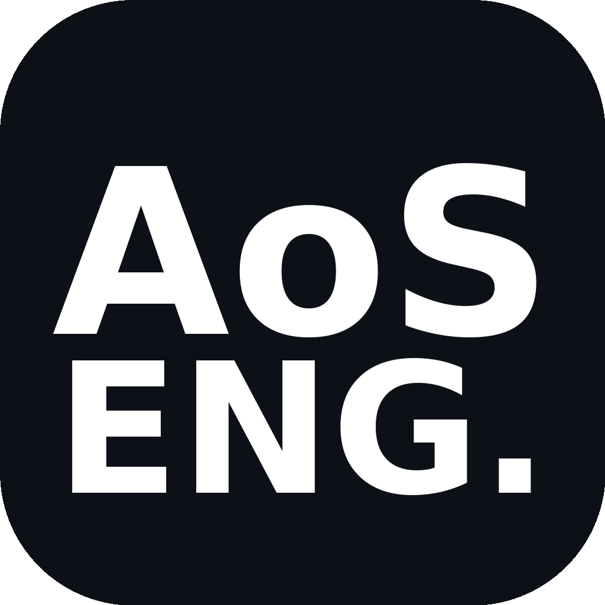

#  Aeros Engine — AoS ENG. v1.26.0 Lite + Full + OpenGL + CUDA + Linux

Интерактивная визуализация обтекания 3D-модели (STL) потоком воздуха: линии тока, частицы,
распределение давления, подъемная сила, шлирен, объемный дым, скачки уплотнения, вихревые трубки, полет 6DOF, LIC, акустика. C++17 / Vulkan 1.3 / OpenGL 4.6 / CUDA / Dear ImGui / GLM. Lite для слабых устройств i3-3xxx / HD 4000 / GT 620M / 4GB RAM / No CUDA.

> v1.26.0 Computation Mode: таймлапс физики F7/F8 (история расчёта, графики, снимки поля давления, экспорт CSV), карта давления с трилинейной интерполяцией и автодиапазоном (общая для CPU и CUDA), постоянные буферы CUDA вместо malloc/free каждый кадр, честный статус Vulkan, исправленные индексы ячеек (floor вместо усечения) в физике; v1.25.0 Debug: режим отладки F9, отладочный отчёт F10 / `--save-report`, журналы `logs\aeros-debug.log` и `logs\physics.csv`, диагностика CUDA с причиной по-русски, автопереход на CPU при ошибке GPU; v1.24.0 PC-релиз: установщики/апдейтеры/портативные для x64, x86 и arm64, базовый набор инструкций SSE2; v1.20.0 Lite: SSE2 only, O1, 1500 частиц, 8x80 линий, voxel 24, LBM OFF 32, 30 FPS, OpenGL 3.3, small binary для i3-3xxx/HD4000/GT620M/4GB RAM; v1.19.0 Vulkan+Linux: Vulkan рендерер с fallback на OpenGL, полный Linux порт, авто-загрузка зависимостей; v1.18.0 Interesting: шлирен |∇ρ|, объемный дым, скачки θ-β-M, вихревые трубки Q, полет 6DOF, LIC, акустика; v1.17.0 Physics Fix: ISA, Sutherland, Venturi 1.6x, BL, wake, St(Re); v1.16.0 FG, v1.15.0 FSR.

## 📥 Скачать (релиз)

Последний релиз: **[GitHub Releases](https://github.com/cumaktimur490-arch/Aeros-Engine/releases)**

### Windows Lite — для слабых устройств i3-3xxx / HD 4000 / GT 620M / 4GB RAM (NEW v1.20.0!)
| Файл | Описание | Система |
|------|----------|---------|
| `Aeros-Engine-Setup-Lite-x64-v*.exe` | **Lite установщик** SSE2 O1 1500 частиц 30 FPS small binary | Win7+ 64-bit, i3-3xxx, HD 4000, 4GB RAM |
| `Aeros-Engine-Portable-Lite-x64-v*.zip` | **Lite портативная** для слабых ноутов | 64-bit Lite |

**Быстрый старт Windows Lite (слабый ноут):**
1. Скачайте `Setup-Lite-x64` — для i3-3xxx / HD 4000 / GT 620M / 4GB RAM / No CUDA
2. Запустите, включите "Download Lite dependencies (minimal)" — только GLFW, GLM, GLAD, модели, без Vulkan SDK
3. Ярлык: Aeros Engine Lite — окно 1024x600, 30 FPS, low настройки, работает на встроенной графике
4. Оптимизировано: SSE2 only (no AVX2), O1 small binary ~5-10 MB, <512 MB RAM, OpenGL 3.3, MSAA 0, VSync ON, power saving

### Windows Full
| Файл | Описание | Система |
|------|----------|---------|
| `Aeros-Engine-Setup-x64-v*-Vulkan-OpenGL.exe` | Full установщик с авто-загрузкой зависимостей | Windows 10+ 64-bit |
| `Aeros-Engine-Setup-x86-v*.exe` | Full установщик | Windows 10+ 32-bit |
| `Aeros-Engine-Setup-arm64-v*.exe` | Full установщик | Windows 10+ ARM64 |
| `Aeros-Engine-Portable-x64-v*-Vulkan-OpenGL.zip` | Full портативная | 64-bit |
| `Aeros-Engine-Portable-x86-v*.zip` | Full портативная | 32-bit |
| `Aeros-Engine-Portable-arm64-v*.zip` | Full портативная | ARM64 |

**Быстрый старт Windows Full (современный ПК):**
1. Скачайте `Setup-x64-Vulkan-OpenGL` для современного ПК
2. Запустите, включите "Download all required dependencies" — установщик скачает GLFW, GLM, GLAD, ImGui, модели, проверит Vulkan
3. Ярлыки: Aeros Engine (Auto), Vulkan, OpenGL, Download Dependencies
4. Выберите STL модель при запуске

### Linux Lite — для слабых ноутов с Linux (NEW v1.20.0!)
| Файл | Описание |
|------|----------|
| `aeros-engine-lite-linux-x64-v*.tar.gz` | Linux Lite x64 SSE2 O1 30 FPS |
| `aeros-engine-lite` binary | Lite бинарь ~5-10 MB |

**Быстрый старт Linux Lite:**
```bash
cd aeros
./build-lite.sh install-deps  # минимальные: glfw, mesa, X11, openmp — без Vulkan
./build-lite.sh deps          # GLM, GLAD
./build-lite.sh all           # сборка Lite SSE2 O1
./bin/aeros-engine-lite --lite --help
./bin/aeros-engine-lite model.stl
```

### Linux Full
| Файл | Описание |
|------|----------|
| `aeros-engine-linux-x64-v*.tar.gz` | Linux Full x64 Vulkan+OpenGL |
| `aeros-engine-linux` binary | Full бинарь |

**Быстрый старт Linux:**
```bash
# Авто-установщик с зависимостями
./installer/install-linux.sh --deps --all
# или для пользователя
./installer/install-linux.sh --user --deps

# Запуск
aeros-engine --help
aeros-engine --vulkan   # force Vulkan
aeros-engine --opengl   # force OpenGL
aeros-engine model.stl  # загрузить модель

# Ручная сборка
cd aeros
./build-linux.sh install-deps   # системные зависимости
./build-linux.sh download-deps  # GLM, GLAD, ImGui
./build-linux.sh all            # сборка
./bin/aeros-engine

# Makefile
make -f Makefile.linux install-deps
make -f Makefile.linux all
./bin/aeros-engine

# Docker
docker build -f packaging/Dockerfile -t aeros-engine .
docker run -it --rm -e DISPLAY=$DISPLAY -v /tmp/.X11-unix:/tmp/.X11-unix aeros-engine
```

## 🎮 Рендереры (v1.26.0 — честный статус)

- **OpenGL 3.3 core** — рабочий рендерер, используется всегда. Проверен на Windows x64/x86/arm64 и Linux.
- **Vulkan** — интерфейс и структура кода есть, **отрисовка не реализована**: функции заглушки
  возвращали «успех», ничего не рисуя. До v1.26.0 `isVulkanAvailable()` отвечала «да» по одному факту
  наличия `vulkan-1.dll` в системе (он есть почти на любом ПК с драйвером видеокарты), из-за чего окно
  создавалось с `GLFW_NO_API` — без контекста OpenGL — и пользователь получал чёрное окно без подсказок,
  а выбор `renderer=vulkan` сохранялся в `aeros_settings.ini` и ломал каждый следующий запуск.
  Теперь наличие загрузчика (`vulkanLoaderPresent()`) отделено от возможности рисовать
  (`isVulkanAvailable()`), приложение всегда работает на OpenGL, а запрос Vulkan пишет
  предупреждение в журнал и в отладочный отчёт.
- CLI: `--vulkan`, `--opengl`, `--help` (запрос Vulkan логируется и приводит к OpenGL)
- Настройки: `aeros_settings.ini` `renderer=auto|opengl`. Запись перезаписывает настройку, а не
  дописывает строку: раньше файл открывался в режиме append, а при запуске читалась первая найденная
  запись, поэтому повторный выбор рендерера молча не применялся.
- UI: секция «Рендерер — Vulkan + OpenGL» — текущий рендерер, статус загрузчика и честная подпись.

## 📦 Авто-загрузка зависимостей при установке (NEW v1.19.0)

**Windows:**
- `installer/download_deps.ps1` — скачивает GLFW (3.3.8 prebuilt), GLM (git), GLAD (glad.h, glad.c, khrplatform.h), ImGui (git), проверяет Vulkan SDK (`VULKAN_SDK` env), создает sample cube STL, default config
- Запускается автоматически в установщике (Task: install_deps) + кнопка "Download Dependencies" в меню Пуск
- Ручной: `powershell -File installer/download_deps.ps1 -Arch x64` или `build.bat deps`
- `build.bat` теперь с `:download_deps` — авто-вызов в начале, Vulkan detection, копирует `vulkan-1.dll`

**Linux:**
- `installer/download_deps_linux.sh` — GLM, GLAD, GLFW headers, ImGui, Vulkan check (`pkg-config vulkan`), sample STL, config, desktop file
- `installer/install-linux.sh --deps` — системные (apt/dnf/pacman/zypper) + bundled
- `aeros/build-linux.sh install-deps|download-deps`

Все необходимые файлы (DLL, модели STL, конфиги) — автоматически при установке!

## ⏱ Режим вычислений: таймлапс физики (NEW v1.26.0)

Физику нельзя отмотать назад — поэтому она записывается. Режим отвечает на вопросы
«что именно происходило в расчёте», «когда он развалился» и «как развивалось обтекание».

| Действие | Как |
|---|---|
| Запись истории | **F7** (или панель «Режим вычислений: таймлапс физики») |
| Просмотр / пауза | **F8** |
| Окно с графиками и полем | открывается автоматически при F7/F8, галочка «Показывать окно таймлапса» |
| Экспорт истории | кнопка «Экспорт CSV» → `logs\timelapse-<дата>.csv` (39 колонок) |
| Автоматически при выходе | если включён режим отладки (F9), история выгружается сама |
| Сводка в отчёте | **F10** — сводка таймлапса входит в `Aeros-Debug-Report-<дата>.txt` |
| Из командной строки | `--timelapse`, `--no-timelapse`, `--timelapse-capacity N`, `--timelapse-field N`, `--timelapse-speed X` |

**Что пишется:** каждый кадр — время, dt, FPS, бэкенд (CUDA/CPU), число частиц и линий тока,
шаг LBM, rho, vmax, TKE, Reynolds, векторы подъёмной силы / сопротивления / момента, центр
давления, времена шести подсистем, счётчик NaN/Inf, остаток сходимости LBM, диапазон Cp.
Каждый 30-й кадр — снимок поля давления `24^3` (работает и без LBM: Cp считается по Бернулли).

**Что показывается:** 10 графиков истории с курсором воспроизведения (FPS, время кадра, время
LBM, подъёмная, сопротивление, TKE, остаток сходимости, vmax, частицы, счётчик NaN/Inf) и три
тепловых среза записанного поля (XY, XZ, YZ) в той же цветовой схеме и диапазоне, которые
действовали в момент записи. Скорость просмотра 0.1x…32x, где 1x — реальное время записи.

**Фоновая история** включена по умолчанию: буфер-кольцо (~5 МБ) пишется постоянно, поэтому к
моменту сбоя запись уже есть. Во время просмотра буфер замораживается, чтобы кольцо не
перезаписывалось под курсором.

## 🎨 Карта давления (v1.26.0)

- Давление берётся **трилинейной интерполяцией** по сетке LBM, а не ближайшей ячейкой: карта
  больше не ступенчатая. Точки вне расчётной области больше не получают «нулевое давление»
  и не рисуются как невозмущённый поток.
- Диапазон раскраски считается **по фактическим данным** (робастно: отсечение 1% крайних
  значений, симметрия относительно нуля, сглаживание), а не зашит как `[-3, +1]`. В старом окне
  Cp = 0 попадал на 75% шкалы и рисовался оранжевым, а всё сжатие сливалось в красный.
- Схема **расходящаяся**: Cp = 0 — нейтральный серый, разрежение — синий, сжатие — жёлто-красный.
  Все четыре схемы работают (раньше «Plasma» для давления игнорировалась).
- **CPU и CUDA красят одинаково**: диапазон и номер схемы передаются в `FlowParams` и
  используются в ядре GPU. Раньше у ядра была своя зашитая шкала, и при переключении бэкенда
  модель меняла цвет.
- Вместо текстовой легенды рисуется **настоящая цветовая шкала** с отметкой нуля и подписями
  фактического диапазона; диапазон можно задать вручную (галочка «Авто-диапазон Cp»).

## 🐞 Режим отладки и журнал (NEW v1.25.0)

Если что-то работает не так — включите журнал и пришлите отчёт: по нему проблему
можно разобрать удалённо, без доступа к вашему компьютеру.

**Быстро:**

| Действие | Как |
|---|---|
| Включить/выключить журнал | `F9` (или панель «Отладка и журнал», или `--debug`) |
| Сохранить отчёт | `F10` (или кнопка «Сохранить отчёт», или `--save-report`) |
| Показать журнал поверх сцены | галочка «Показывать журнал поверх сцены» / `--debug-overlay` |
| Перепроверить CUDA | кнопка «Перепроверить CUDA» в панели «Отладка и журнал» |

**Что создаётся** (в папке программы; если она только для чтения — в
`%LOCALAPPDATA%\AerosEngine` на Windows или `~/.aeros` на Linux):

- `logs\aeros-debug.log` — журнал событий: запуск, версии, железо (ОС, разрядность,
  CPU, SSE2/AVX/AVX2, память, PE-машина запущенного exe), OpenGL, состояние CUDA,
  модель, **все действия пользователя** (каждое изменение параметров — что и на какое
  значение), предупреждения и ошибки. Запись сбрасывается на диск после каждой строки,
  поэтому журнал не обрывается при падении.
- `logs\physics.csv` — журнал физики по кадрам: dt, FPS, бэкенд, число частиц и линий
  тока, шаг LBM, rho, vmax, TKE, Re, силы и моменты, времена всех подсистем и счётчик
  неконечных значений (NaN/Inf). Удобно открывать в Excel и строить графики.
- `Aeros-Debug-Report-<дата>.txt` — **единый отчёт**: всё перечисленное плюс текущие
  параметры и последние 400 строк журнала. Именно этот файл нужно присылать.

**Ключи командной строки:** `--debug`, `--debug-actions`, `--debug-physics`,
`--debug-overlay`, `--physics-every N` (строка физики каждый N-й кадр, по умолчанию 4),
`--save-report`.

**Если программа не запускается**, выполните в её папке:

```bat
main.exe --save-report
```

Отчёт создастся без окна и графики (проверка CUDA выполняется тоже), а путь к файлу
будет показан в диалоге.

**CUDA.** При старте движок выполняет пробу бэкенда: перечисляет устройства NVIDIA,
читает имя GPU, compute capability, объём памяти, версии драйвера и CUDA и реально
запускает тестовое ядро. Причина недоступности пишется по-русски в панелях
«Отладка и журнал» и «Вычисления и Экспорт», а также в отчёт: GPU не найден, драйвер
слишком старый, GPU старше Turing (нет машинного кода для этой архитектуры), GPU занят,
не хватило памяти, сборка без CUDA. При любой ошибке GPU во время расчёта движок в том
же кадре переходит на CPU-бэкенд и автоматически сохраняет отчёт.

## 🌟 Возможности

### Аэродинамика (v1.17.0 Physics Fix)
- ISA 7 слоев 0-80км с pBase continuity, Sutherland mu(T), плотность/давление/температура/a
- Re=rho*V*L/mu, Mach M=V/a, Cp=(p-p_inf)/q, Bernoulli 1-(V/Vinf)², Prandtl-Glauert beta=sqrt(1-M²)
- Drag polar Cd=Cd0+Cd_i+Cd_wave+Cd_base, Cf Blasius 0.664/sqrt(Re_x) + Schlichting 0.455/log10(Re)^2.58, Cd_i=Cl²/(πAR e), AR=span²/ref, base drag flowDotN>0.7, ground effect Venturi 1.6x mass cons, wake sqrt(D/x) Gaussian b∝sqrt(x), St(Re) Karman, Stratford separation, LBM tau из Re, Smagorinsky (Cs*dx)²|S| van Driest, Stokes

### Интересные визуализации (v1.18.0)
- **Шлирен |∇ρ| и Shadowgraph ∇²ρ** — как в реальной сверхзвуковой трубе, нож Фуко
- **Объемный дым** — 48x32x32 сетка + 20k частиц, ray marching T=exp(-∫σρds), buoyancy, turbulence
- **Скачки уплотнения** — θ-β-M tanθ=2cotβ(M²sin²β-1)/(M²(γ+cos2β)+2), Mach angle μ=arcsin(1/M), Prandtl-Meyer ν(M)
- **Вихревые трубки** — Q>5, |ω|>√10, кластеризация, трассировка вдоль ω, helicity H=v·ω coloring
- **Полет 6DOF** — F=ma, M=Iα, lift+drag+thrust+gravity, ground reaction, auto-trim, Takeoff!
- **LIC** — Line Integral Convolution 256², skin friction lines
- **Акустика** — Lighthill T_ij=ρ v_i v_j, 1/r², 100 источников
- **Температура** — T0/T=1+(γ-1)/2 M², нагрев от скачка и трения
- **Streaklines** — история окрашенного дыма
- 17 режимов визуализации, 8 пресетов

### Рендер и оптимизации
- **Vulkan 1.3 + OpenGL 4.6** — auto-select, оба рабочие, CLI --vulkan/--opengl
- **FSR 1.0** — EASU 12-tap + RCAS sharpening, dynamic resolution, 33-77% scale
- **Frame Generation** — motion vectors из depth+camera+аэродинамика, motion-compensated interpolation, 2x/3x/4x, FSR+FG combo
- Frustum culling, Early-Z, LOD, VRS, async compute

### Базовые
- STL загрузка (бинарный/ASCII), вокселизация SDF 26-neighbor Euclidean Fast Sweeping, частицы 15k-200k, линии тока RK45 adaptive, Cp, lift/drag/moment/CoP, ground effect, slice plane, ISA атмосфера, единицы скорости м/с км/ч mph kts ft/s, x64/x86/arm64, Linux/Windows

## Сборка

### Windows
Требуется: Visual Studio 2022, CUDA Toolkit опционально, Vulkan SDK опционально (для Vulkan рендерера, иначе OpenGL fallback)
```bat
cd aeros
build.bat deps          # скачать зависимости (GLFW, GLM, GLAD, ImGui)
build.bat               # x64 Vulkan+OpenGL auto
build.bat x64           # x64
build.bat x86           # x86
build.bat vulkan        # Vulkan only
build.bat opengl        # OpenGL only
build.bat clean         # очистка
```

### Linux
```bash
cd aeros
./build-linux.sh install-deps   # системные зависимости (apt/dnf/pacman)
./build-linux.sh download-deps  # bundled (GLM, GLAD, ImGui)
./build-linux.sh check-deps     # проверка
./build-linux.sh all            # auto Vulkan+OpenGL
./build-linux.sh vulkan         # Vulkan only
./build-linux.sh opengl         # OpenGL only
./bin/aeros-engine --help

# Makefile
make -f Makefile.linux install-deps
make -f Makefile.linux all
make -f Makefile.linux package
```

### CMake (Windows и Linux)
```bash
cmake -B build -DAEROS_ENABLE_VULKAN=ON -DAEROS_DOWNLOAD_DEPS=ON
cmake --build build --config Release
# Linux
cmake -B build && cmake --build build
./build/aeros-engine --help
```

### Docker
```bash
docker build -f packaging/Dockerfile -t aeros-engine .
docker run -it --rm -e DISPLAY=$DISPLAY -v /tmp/.X11-unix:/tmp/.X11-unix aeros-engine
```

## Linux Port Details

- **File dialog**: zenity (`zenity --file-selection`) или kdialog или fallback к `./models/`, `/usr/share/aeros-engine/`, консольный ввод
- **Зависимости**: `libglfw3-dev libgl1-mesa-dev libx11-dev libxrandr-dev libxinerama-dev libxcursor-dev libxi-dev libvulkan-dev vulkan-tools glslc zenity kdialog libopenmp-dev`
- **Установка**: `installer/install-linux.sh --deps --all` — ставит в `/usr/local/bin/aeros-engine`, модели в `/usr/local/share/aeros-engine/models/`, desktop в `/usr/local/share/applications/aeros-engine.desktop`, иконку в `/usr/local/share/icons/...`
- **User install**: `installer/install-linux.sh --user --deps` — в `~/.local/bin/`
- **Uninstall**: `installer/uninstall-linux.sh --prefix /usr/local` или `--user`
- **Vulkan**: `sudo apt install libvulkan-dev vulkan-tools`, проверка `vulkaninfo --summary`, `pkg-config --modversion vulkan`
- **OpenGL**: всегда работает, даже без Vulkan

## Релизы (PC)

PC-релизы публикуются в Releases по тегу `vX.Y.Z` и собираются GitHub Actions
(`.github/workflows/pc-release.yml`) в формате прежних PC-версий:
установщики `Aeros-Engine-Setup-<arch>-vX.Y.Z.exe`, апдейтеры
`Aeros-Engine-Update-<arch>-vX.Y.Z.exe` и портативные
`Aeros-Engine-Portable-<arch>-vX.Y.Z.zip` для x64 / x86 / arm64,
плюс `SHA256SUMS.txt` и `README.md` — 11 файлов. x64 — с CUDA, x86/arm64 — CPU-сборки.

С v1.25.0 CI проверяет, что x64 действительно собран через `nvcc`: скрипты сборки
пишут маркер `aeros\bin\BUILD-BACKEND-<arch>.txt` (`CUDA` / `CPU_ONLY`), и при
маркере, отличном от `CUDA`, публикация релиза останавливается — раньше тихий
переход на CPU-only приводил к релизу с неработающей CUDA. CUDA-код собирается как
`-gencode arch=compute_75,code=[sm_75,compute_75]`: SASS для Turing плюс PTX для
более новых GPU (Ampere / Ada / Blackwell).

Локально: `aeros\build.bat [x64|x86]` (CUDA), `aeros\build-cpu.bat [x64|x86|arm64]` (CPU),
установщики — `installer\build-installers.ps1`, портативные — `installer\build-portable.ps1`
(Inno Setup 6; GLFW для x86/arm64 подтянут `tools\get-glfw-x86.ps1` / `tools\build-glfw-arm64.ps1`).

## Лицензия


GoGonam AoS. 2026 — MIT (см. LICENSE)

## Ссылки

- GitHub: https://github.com/cumaktimur490-arch/Aeros-Engine
- Releases: https://github.com/cumaktimur490-arch/Aeros-Engine/releases
- Vulkan SDK: https://vulkan.lunarg.com/
- GLFW: https://www.glfw.org/
